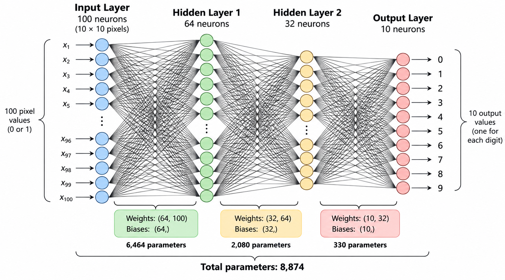

# Neural Network Digit Recognition — Python & NumPy

A handwritten digit recognition project built from scratch using **Python and NumPy**, without TensorFlow or PyTorch.

The network recognizes digits **0–9** from **10 × 10 black-and-white pixel drawings**. You can train a model, save its weights, and test drawings using a terminal or the browser-based pixel drawer.

## Architecture

**100 → 64 → 32 → 10**

- **100 input neurons:** one for each pixel of a 10 × 10 image
- **64 neurons:** first hidden layer
- **32 neurons:** second hidden layer
- **10 output neurons:** one for each digit, 0–9



The network uses forward propagation and backpropagation to learn weights and biases.

## Requirements

- Python 3.12
- NumPy
- VS Code and Docker Desktop (optional, for Dev Containers)

Install the Python dependency if needed:

```bash
pip install numpy
```

## Getting started

Open the project folder in VS Code. If using the supplied Dev Container, run **Dev Containers: Reopen in Container**. Otherwise, use a local Python environment.

Run all commands from the project root.

## Train the model

```bash
python train.py
```

The training script loads labeled digit examples and trains the neural network. The saved weights and biases are stored at:

```text
models/model.npz
```

## Draw a digit

Open **`pixel_drawer.html`** in your browser.

- **Draw:** color pixels black
- **Erase:** remove black pixels
- **Clear:** reset the grid
- **Copy 100 values:** copy the drawing as a Python list
- **Save PNG:** export the drawing as an image

Each drawing contains exactly **100 values** in row-major order (left to right, top to bottom):

- `0` = white pixel
- `1` = black pixel

## Guess a digit

Make sure you've trained and saved the model, then run:

```bash
python guess.py
```

The script loads `models/model.npz` and prompts:

```text
Paste pixels (or 'exit'):
```

Draw a digit in `pixel_drawer.html`, click **Copy 100 values**, paste the complete list into the terminal, and press **Enter**.

The script prints a score for each digit and the digit with the highest score:

```text
Digit 0: 0.32%
Digit 1: 0.15%
Digit 2: 1.25%
Digit 3: 94.12%
...
Prediction: 3
```

The scores come from the network's sigmoid outputs; they are **not calibrated probabilities** and need not sum to 100%.

Paste another drawing to guess again, or type `exit` to quit.

## Project files

| File | Purpose |
| --- | --- |
| `neural_network.py` | Neural network and training logic |
| `train.py` | Train the model |
| `guess.py` | Interactive terminal-based digit prediction |
| `pixel_drawer.html` | Draw 10 × 10 images and copy pixel data |
| `image.png` | Diagram of the network architecture |
| `models/model.npz` | Saved trained weights and biases |
| `data/` | Training datasets and data loader |

## How prediction works

1. Convert a 10 × 10 drawing into 100 pixel values.
2. Pass those values through the 64-neuron and 32-neuron hidden layers.
3. Produce 10 output scores, one per digit.
4. Select the digit with the highest score.

## Limitations

This is an educational implementation. Recognition accuracy depends on the variety of training images and may be lower for new drawing styles. With only 10 × 10 pixels, even small changes can affect the result.
